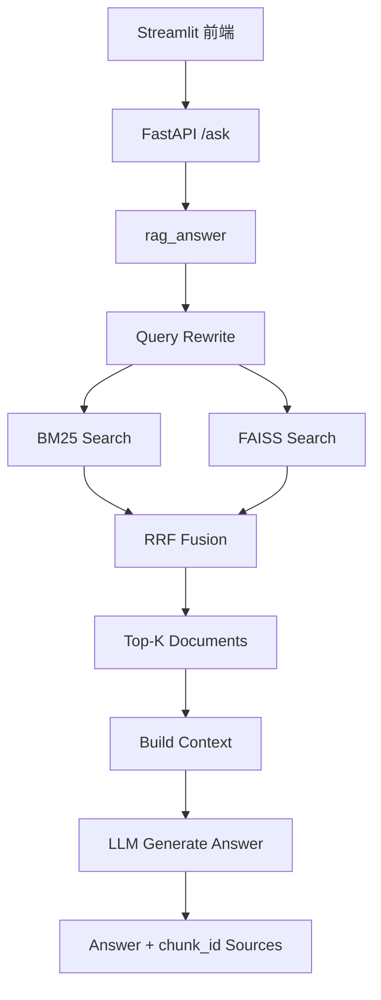
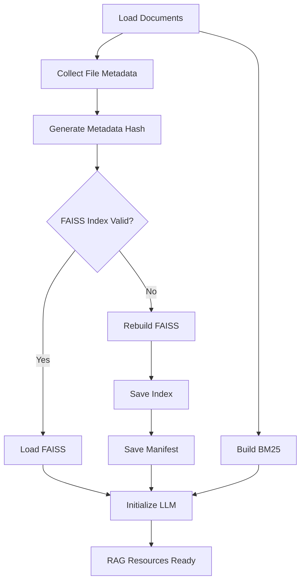

# Industrial Wastewater AI

一个面向工业污水业务场景的 RAG 智能问答系统。

项目基于真实外委污水业务流程和企业知识文档构建，目标不是单纯实现“文档问答”，而是探索如何将企业制度、SOP、业务手册等非结构化知识转化为一个**可检索、可评估、可部署、可追溯**的 AI 业务助手。

当前版本已经完成 RAG V1.0 核心链路，包括：

- 文档加载
- BM25 检索
- FAISS 向量检索
- Query Rewrite
- RRF 融合
- 检索效果评估
- FAISS 索引持久化与有效性校验
- FastAPI 后端
- Streamlit 前端
- 基础单元测试
- 真实业务问题人工回归验证

---

# 1. 项目背景

工业污水业务中的关键知识通常分散在多个不同来源中，例如：

- 企业制度
- SOP
- 外委污水业务手册
- 客户准入要求
- 水质评估流程
- 合同审批流程
- 安全环保要求
- 部门职责文件
- 业务经验记录

实际工作中，这种知识组织方式会带来几个问题：

1. 新人需要频繁询问有经验人员；
2. 制度和业务资料较多，人工查找效率较低；
3. 用户通常使用口语表达，而知识文件采用正式业务术语；
4. 单纯关键词搜索很难覆盖真实业务问题；
5. LLM 如果脱离企业知识库直接回答，容易出现不可追溯或不准确的内容。

因此，本项目尝试构建一个面向工业污水业务的企业知识库 RAG 系统。

核心目标是：

> 让用户可以直接用自然语言提问，由系统检索企业内部知识，并基于真实资料生成带来源的业务回答。

---

# 2. 系统整体架构

当前系统由 Streamlit 前端、FastAPI 后端以及 RAG 核心模块组成。



完整问答流程为：

```text
用户问题
    ↓
Query Rewrite
    ↓
BM25 + FAISS
    ↓
RRF Fusion
    ↓
Top-K Documents
    ↓
Build Context
    ↓
LLM
    ↓
最终答案 + 来源
```

---

# 3. Query Rewrite

真实用户通常不会按照制度文件中的标准术语进行提问。

例如用户可能问：

```text
客户想把废水送到咱们厂处理，
咱们怎么提前确认这个活到底能不能接？
```

而企业知识文件中可能使用：

```text
可行性评估
接收条件
客户准入
工艺处理可行性
```

因此，系统首先通过 LLM 将用户问题改写为更适合企业知识库检索的查询。

例如：

```text
原始问题：

客户想把废水送到咱们厂处理，
咱们怎么提前确认这个活到底能不能接？

↓

Rewritten Query：

外部废水接收前可行性评估与可接收性确认应审核哪些方面？
```

这里需要区分两个 Query 的用途：

```text
Original Query
→ 用于最终回答

Rewritten Query
→ 用于知识库检索
```

也就是说，Query Rewrite 只负责改善 Retrieval，不改变用户真正想问的问题。

---

# 4. 混合检索

当前 V1 使用两路检索：

```text
Rewritten Query
       ↓
 ┌─────────────┐
 │             │
BM25         FAISS
 │             │
 └──────┬──────┘
        ↓
    RRF Fusion
```

## BM25

BM25 更擅长：

- 标准业务术语
- 明确关键词
- 制度名称
- 部门名称
- 固定业务表达

## FAISS

FAISS 基于 Embedding 进行向量语义检索，更擅长：

- 语义相似问题
- 表达方式不同但意图相同的问题
- 口语化问题

当前 Embedding 模型：

```text
BAAI/bge-m3
```

---

# 5. RRF 融合

BM25 和 FAISS 返回的是两个独立排序列表。

项目使用 RRF（Reciprocal Rank Fusion）进行结果融合。

核心思想是：

```text
RRF Score ≈ 1 / (k + rank)
```

相比直接融合 BM25 Score 和 Vector Similarity Score，RRF 更关注：

> 一个 Document 在两个 Retriever 中分别排在什么位置。

这样可以避免不同检索器 Score 范围不同导致的直接比较问题。

当前最终检索链路：

```text
Query Rewrite
+
BM25
+
FAISS
+
RRF
```

---

# 6. Retrieval Evaluation

为了避免仅凭主观感觉选择检索方案，项目建立了 Retrieval Evaluation 数据集。

当前主要使用两个指标：

## Hit@3

如果正确 chunk 出现在 Top-3：

```text
Hit@3 = 1
```

否则：

```text
Hit@3 = 0
```

用于衡量：

> 正确知识是否能够被召回。

---

## MRR@3

MRR（Mean Reciprocal Rank）同时考虑正确答案的位置。

例如：

```text
正确答案排名第 1 → 1
正确答案排名第 2 → 1/2
正确答案排名第 3 → 1/3
Top-3 未出现     → 0
```

因此它不仅关注“有没有找到”，也关注：

> 正确知识有没有被排到更靠前的位置。

---

# 7. Query Rewrite Evaluation

实际实验发现：

对正式业务问法，BM25 表现较好。

但在真实口语问题中，BM25 的表现明显下降，而 FAISS 对自然语言表达更加稳定。

因此项目进一步加入 Query Rewrite。

由于 LLM 每次改写可能存在一定波动，为保证不同 Retrieval Strategy 可以公平比较，评估阶段将 rewritten query 固定在 Evaluation Dataset 中。

数据结构例如：

```json
{
  "id": "Q006",
  "question": "客户想把废水送到咱们厂处理，咱们怎么提前确认这个活到底能不能接？都需要看哪些方面？",
  "rewritten_query": "外部废水接收前可行性评估与可接收性确认应审核哪些方面？",
  "relevant_chunk_ids": ["F002_C012"]
}
```

这样可以避免：

```text
不同模型改写
→ 不同 Query
→ Retrieval 结果变化
→ Evaluation 无法公平比较
```

---

# 8. 最终检索方案对比

在固定 Query Rewrite 后，对以下两种方案进行对照：

| Retrieval Strategy | Hit@3 | MRR@3 |
|---|---:|---:|
| Query Rewrite + FAISS | 70% | 58.33% |
| Query Rewrite + BM25 + FAISS + RRF | 70% | 65.00% |

最终采用：

```text
Query Rewrite
→ BM25 + FAISS
→ RRF
```

原因是：

Hit@3 保持一致，但 MRR@3 从：

```text
58.33%
```

提高到：

```text
65.00%
```

说明在成功召回正确知识的情况下，混合检索能够使相关 Document 整体获得更靠前的排序。

---

# 9. RAG 核心流程

核心 orchestration 位于：

```text
src/rag.py
```

主要数据流：

```text
query
↓
rewrite_query()
↓
rewritten_query
↓
bm25_search()
+
faiss_search()
↓
rrf_fusion()
↓
build_context()
↓
generate_answer()
↓
answer
```

`rag.py` 负责串联整个业务流程。

各底层模块负责具体实现，而 `rag.py` 作为统一调度层。

---

# 10. Context Construction

RRF 返回的数据结构类似：

```python
[
    {
        "document": Document(...),
        "score": ...
    }
]
```

RRF Score 主要负责排序。

进入 Context Construction 后，只需要：

```text
Document.page_content
Document.metadata["chunk_id"]
```

系统取 Top-K Document，并构建：

```text
来源：F010_C015
内容：...

----------

来源：F002_C012
内容：...
```

随后将 Context 和用户原始问题一起发送给 LLM。

---

# 11. Answer Generation

LLM 被要求：

- 严格依据 Context 回答；
- 不允许脱离资料编造；
- 资料不足时明确说明；
- 回答时引用 chunk_id。

最终回答示例：

```text
安全环保部负责判断接收废水是否属于危险废物。

内部评估阶段，需要结合客户水质指标及相关材料，
由安全环保部确认废水属性。

如属于危险废物，则停止后续接收流程。

来源：F010_C004、F010_C013
```

---

# 12. FAISS Persistence

为了避免每次启动都重新进行 Embedding 和 FAISS Index 构建，项目实现了 FAISS 持久化。

索引目录：

```text
data/faiss_index/
├── index.faiss
├── index.pkl
└── manifest.json
```

启动流程：



系统会：

1. 扫描知识库文件；
2. 收集文件 metadata；
3. 对 metadata 生成 SHA256 Hash；
4. 与 `manifest.json` 中保存的 Hash 比较；
5. 判断当前 FAISS Index 是否仍然有效。

如果一致：

```text
Load existing FAISS index
```

如果不一致：

```text
Rebuild FAISS index
→ Save index
→ Save new manifest
```

这样可以兼顾：

- 启动速度
- Embedding API 成本
- Index 一致性

---

# 13. FastAPI

后端使用 FastAPI 提供：

```text
POST /ask
```

FastAPI 启动时通过 lifespan 初始化：

```text
Documents
BM25
Embedding Model
FAISS
LLM
```

并保存在：

```text
app.state
```

请求到来时直接复用现有资源，而不是重新加载。

数据流：

```text
HTTP Request
↓
/ask
↓
rag_answer()
↓
Answer
↓
HTTP Response
```

---

# 14. Streamlit

Streamlit 负责提供简单 Web UI。

用户输入问题后：

```text
Streamlit
↓
POST http://127.0.0.1:8000/ask
↓
FastAPI
↓
RAG
↓
Answer
↓
Streamlit 页面展示
```

当前已经完成：

```text
Streamlit
→ FastAPI
→ Query Rewrite
→ BM25
→ FAISS
→ RRF
→ Context
→ LLM
→ Answer
```

完整链路联调。

---

# 15. 真实业务回归测试

当前已经使用真实业务问题进行人工回归。

例如：

```text
这个水到底算不算危废，谁来判断？
```

系统能够检索：

```text
安全环保部职责
+
内部评估流程
+
危险废物接收原则
```

并生成带来源回答。

---

例如：

```text
合同在公司内部怎么审批？
```

系统能够综合：

```text
合同拟定
+
安全环保协议
+
OA 合同审批
+
经理办公室审核
+
签字盖章
```

形成完整业务回答。

---

例如：

```text
水质跟之前报的不一样怎么办？
```

知识库中并没有一个完整直接对应的“水质异常处理 SOP”。

系统没有直接编造一个标准流程，而是：

1. 核对水质检测结果；
2. 根据新的水质重新评估；
3. 重新进行商务报价；
4. 重新确认是否能够接收；
5. 明确指出资料中缺少完整异常处置流程。

这也是当前系统希望实现的一个重要目标：

> 在资料不足时，不让 LLM 伪造企业规则。

---

# 16. 项目结构

```text
industrial-wastewater-ai/
│
├── main.py
├── api.py
├── app.py
├── evaluate.py
│
├── src/
│   ├── loader.py
│   ├── retrieval.py
│   ├── fusion.py
│   ├── query_processing.py
│   ├── indexing.py
│   └── rag.py
│
├── data/
│   ├── processed/
│   ├── eval/
│   └── faiss_index/
│
├── tests/
│
└── README.md
```

---

# 17. Module Responsibilities

## `loader.py`

负责：

```text
Processed Data
→ LangChain Document[]
```

---

## `retrieval.py`

负责：

```text
BM25
FAISS
```

包括：

- BM25 构建
- BM25 Search
- FAISS 构建
- FAISS Search

---

## `query_processing.py`

负责：

```text
Original Query
→ Rewritten Query
```

目标是缩小：

```text
User Language
vs
Enterprise Knowledge Language
```

之间的差距。

---

## `fusion.py`

负责：

```text
BM25 Results
+
FAISS Results
↓
RRF
↓
Ranked Results
```

---

## `indexing.py`

负责：

```text
File Metadata
↓
Hash
↓
Manifest
↓
Index Validation
```

---

## `rag.py`

整个 RAG 系统的 orchestration 层：

```text
Rewrite
→ Retrieval
→ Fusion
→ Context
→ Generation
```

---

## `api.py`

负责：

```text
FastAPI
/ask
RAG Resource Initialization
```

---

## `app.py`

负责：

```text
Streamlit UI
HTTP Request
Answer Display
```

---

# 18. Document Ingestion Prototype

除主项目外，还单独构建了一个 Document Ingestion Prototype，用于理解企业 RAG 文档接入层。

Prototype 支持：

```text
.md
.txt
.json
.pdf
.docx
```

核心架构：

```text
File
↓
Dispatcher
↓
Parser
↓
Metadata Normalization
↓
Document[]
```

不同文件格式由不同 parser 处理，但最终全部统一输出：

```python
Document(
    page_content=...,
    metadata=...
)
```

后续 Chunking、Embedding 和 Retrieval 可以直接面向统一的 `Document[]` 接口。

该 prototype 主要用于学习：

- Dispatcher
- Parser
- Metadata Normalization
- Unified Document Interface

暂未加入主 RAG 项目。

---

# 19. Tests

项目已经针对部分核心模块编写 Pytest 测试，包括：

- loader
- context construction
- evaluation metrics
- indexing
- RRF fusion
- retrieval evaluation

当前部分旧测试与最新实验代码仍存在接口不同步问题，例如：

- Evaluation Function 重命名；
- Evaluation Dataset 增加 `id`；
- RRF 从等权调整为 weighted RRF。

这些属于 V1 收口后的测试同步工作，不影响当前主链路运行。

---

# 20. 当前已知问题

## Evaluation Dataset 较小

当前评估问题数量较少。

因此：

```text
Hit@3
MRR@3
```

主要用于 Retrieval Strategy 之间的相对比较。

不能将当前数字理解为大规模 Benchmark。

---

## Query Rewrite 存在波动

即使使用：

```text
temperature = 0
```

不同 LLM 调用仍可能产生略有差异的 Rewrite。

因此 Evaluation 中已经固定 rewritten query。

---

## 部分问题仍存在召回失败

例如：

- 危险废物属性判断
- 部分合同相关问题
- 水质异常问题

仍存在正确 Document 未进入 Top-3 的情况。

未来可以继续研究：

- Retrieval Dataset Expansion
- Chunk Optimization
- Query Rewrite Optimization
- Reranker
- Metadata Enrichment

---

# 21. 为什么暂时没有加入 Reranker

当前 V1 首先完成：

```text
Rewrite
→ Hybrid Retrieval
→ RRF
```

虽然部分正确 Document 会出现在 Top-5 而非 Top-3，但当前阶段尚未直接加入 Reranker。

原因是希望先通过 Evaluation 判断：

```text
问题来自 Recall？
还是 Ranking？
```

如果后续扩大评估集后发现：

```text
Hit@5 很高
但 Hit@3 / MRR 较低
```

则说明：

```text
Recall 正常
Ranking 存在问题
```

此时引入 Reranker 才有明确工程依据。

---

# 22. Technology Stack

### Language

```text
Python
```

### RAG

```text
LangChain
BM25
FAISS
RRF
```

### Embedding

```text
BAAI/bge-m3
```

### LLM

```text
DeepSeek
```

### Backend

```text
FastAPI
```

### Frontend

```text
Streamlit
```

### Testing

```text
Pytest
```

---

# 23. Current Status

当前版本：

```text
RAG V1.0
```

已经完成：

- [x] Document Loading
- [x] BM25 Retrieval
- [x] FAISS Retrieval
- [x] Query Rewrite
- [x] Hybrid Retrieval
- [x] RRF Fusion
- [x] Retrieval Evaluation
- [x] Hit@3
- [x] MRR@3
- [x] Fixed Rewritten Query Evaluation
- [x] Context Construction
- [x] LLM Answer Generation
- [x] Source Citation
- [x] FAISS Persistence
- [x] Manifest / Hash Validation
- [x] FastAPI
- [x] Streamlit
- [x] Real Business Question Testing

---

# 24. Next Steps

下一阶段不会优先继续增加 Retrieval 组件，而是重点提高：

## Evaluation

- 扩大评估问题集；
- 增加 Hard Cases；
- 增加 Failure Cases；
- 完善 Regression Dataset。

## Observability

记录：

```text
Original Query
Rewritten Query
Retrieved Documents
Retrieval Scores
Latency
Token Usage
```

## Retrieval Quality

根据 Evaluation 决定是否增加：

```text
Reranker
Metadata Retrieval
Chunk Optimization
```

## Engineering

进一步研究：

```text
Error Handling
Logging
Configuration Management
Deployment
Authentication
Concurrency
Caching
```

---

# 25. Project Goal

这个项目最终关注的并不是：

> “用了多少 RAG 技术组件。”

而是完整解决：

```text
真实业务问题
↓
企业知识整理
↓
Document Processing
↓
Retrieval Design
↓
Evaluation
↓
Engineering
↓
API
↓
User Interface
↓
Business Validation
```

最终目标是探索：

> 如何将 RAG / LLM 技术真正应用于工业企业知识管理、业务流程辅助和专业知识问答场景。